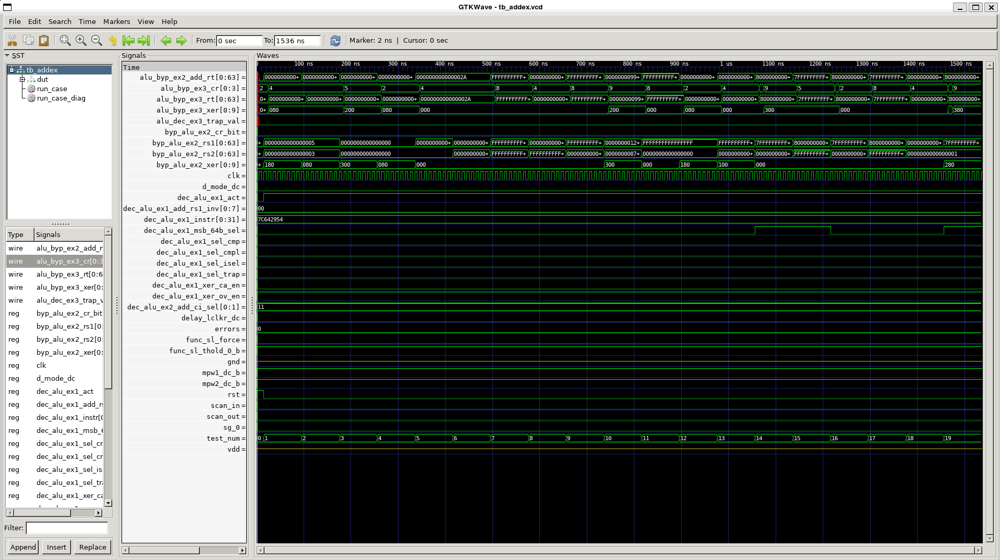
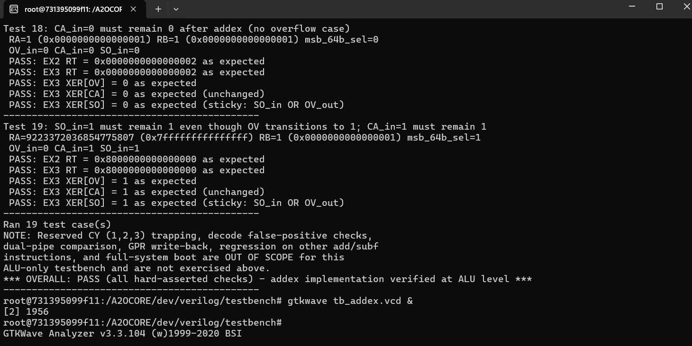
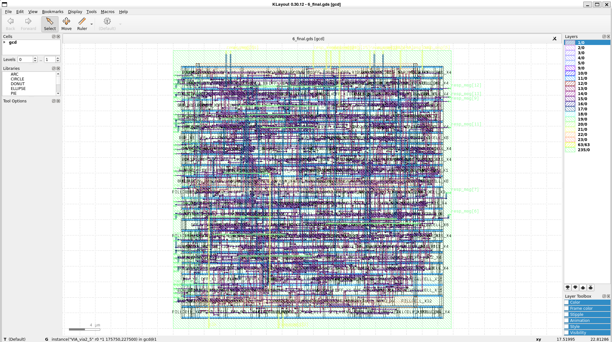

# addex: showcase

Added the `addex` instruction to A2O: decode in `xu0_dec.v` and `xu1_dec.v`, OV carry-in in `xu_alu.v`, and a 19-case ALU testbench. The testbench result is `*** OVERALL: PASS` (see `addex_test_result.txt`).

## Test result

## Waveform

## Layout (gcd example flow)

